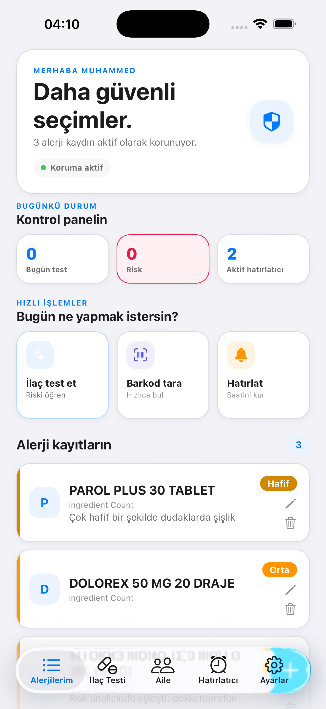
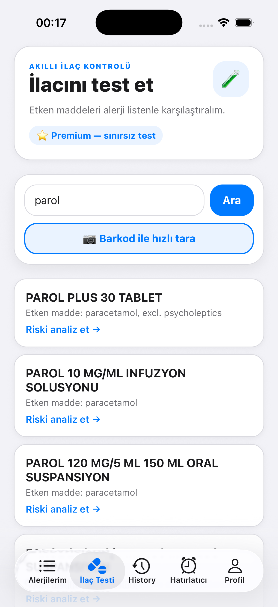
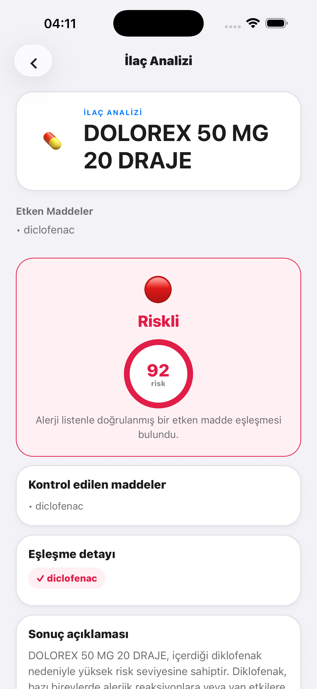
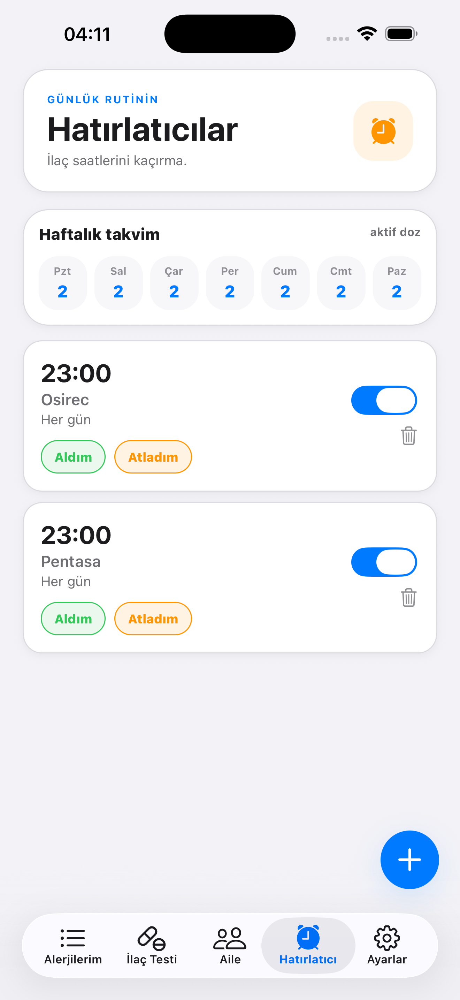
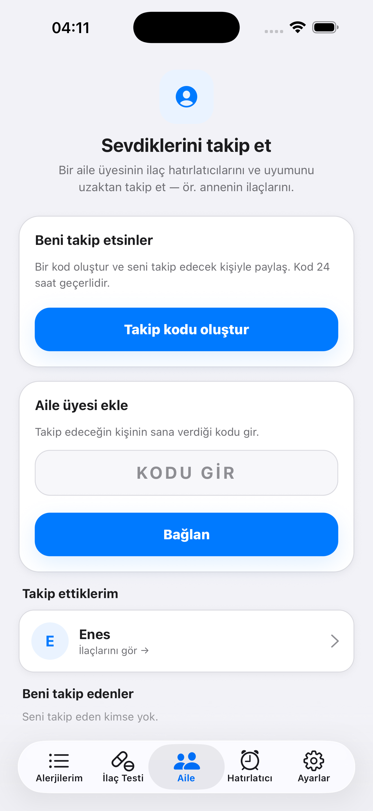
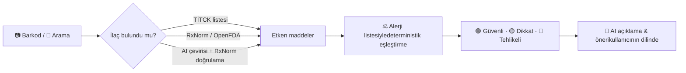
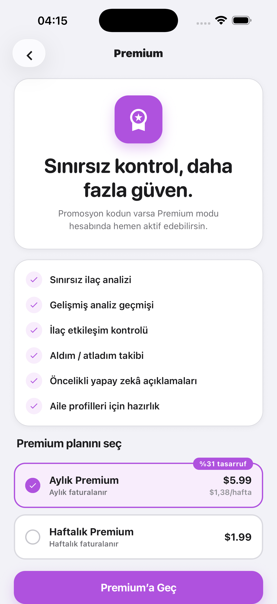

<div align="center">

# AllergyGuard

**İlaçlarını alerji listene göre saniyeler içinde kontrol et.**

Barkodu okut ya da ilacı ara — AllergyGuard etken maddeleri senin alerjilerinle karşılaştırır,<br/>
riski açıkça gösterir ve ilaç saatlerini kaçırmamanı sağlar.

<br/>

[](https://docs.expo.dev/versions/v54.0.0/)
[](https://reactnative.dev)
[](https://www.typescriptlang.org)
[](https://supabase.com)

</div>

---

> [!IMPORTANT]
> AllergyGuard bir **bilgilendirme aracıdır**, doktor veya eczacı tavsiyesinin yerine geçmez. Herhangi bir ilacı kullanmadan önce mutlaka bir sağlık profesyoneline danış.

## 📑 İçindekiler

- [Özellikler](#-özellikler)
- [Nasıl Çalışır?](#-nasıl-çalışır)
- [Kullanılan Teknolojiler](#-kullanılan-teknolojiler)
- [Veri Kaynakları](#-veri-kaynakları)
- [Proje Yapısı](#-proje-yapısı)
- [Kurulum](#-kurulum)
- [Supabase Kurulumu](#-supabase-kurulumu)
- [Ücretsiz vs Premium](#-ücretsiz-vs-premium)
- [Komutlar](#-komutlar)
- [Gizlilik & Güvenlik](#-gizlilik--güvenlik)
- [Uygulama Neden App Store'da Yok?](#-uygulama-neden-app-storeda-yok)

---

## ✨ Özellikler

Görseller farklı geliştirme sürümlerinden alınmıştır; güncel arayüzde küçük farklılıklar olabilir.

<table>
<tr>
<td width="50%" valign="top">

### 🧾 Alerji Profili

İlaç, etken madde ve reaksiyonlarını **hafif / orta / şiddetli** önem derecesiyle tek yerde tut. Onboarding'de sık görülen alerjilerden hızlıca seçim yap.

<p align="center">
  <a href="docs/screenshots/home.png"></a>
</p>

</td>
<td width="50%" valign="top">

### 📷 İlaç Arama & Barkod Tarama

İlacı adıyla ara veya kutusunun barkodunu kamerayla okut; **~7.900 ilaçlık TİTCK listesi** üzerinden ilaç ve etken maddeleri anında bulunur.

<p align="center">
  <a href="docs/screenshots/drug-test.png"></a>
</p>

</td>
</tr>
<tr>
<td valign="top">

### 🛡️ Risk Analizi

Etken maddeler alerjilerinle **deterministik** olarak eşleştirilir ve sonuç <kbd>🟢 Güvenli</kbd> <kbd>🟡 Dikkat</kbd> <kbd>🔴 Tehlikeli</kbd> olarak gösterilir.

<p align="center">
  <a href="docs/screenshots/analysis.png"></a>
</p>

</td>
<td valign="top">

### 💊 Etkileşim Kontrolü

Birden fazla ilacı karşılaştır; aynı ilaç veya ortak etken madde içeren kombinasyonlar için uyarı al.

</td>
</tr>
<tr>
<td valign="top">

### ⏰ İlaç Hatırlatıcıları

Günde birden fazla saat tanımlanabilen, **internetsiz çalışan** yerel bildirimler. iOS ana ekran **widget'ı** ile sıradaki dozu bir bakışta gör.

<p align="center">
  <a href="docs/screenshots/reminders.png"></a>
</p>

</td>
<td valign="top">

### 👨‍👩‍👧 Aile & Bakım Veren Modu

Aile üyelerinin alerjilerini ve ilaçlarını kendi hesabından yönet; çocukların ve yaşlı yakınların için de kontrol yap.

<p align="center">
  <a href="docs/screenshots/family.png"></a>
</p>

</td>
</tr>
<tr>
<td valign="top">

### 🚑 Acil Durum Kartı

Alerjilerini özetleyen, acil durumda sağlık personeline gösterebileceğin kart.

</td>
<td valign="top">

### 🌍 Çift Dil & Tema

Türkçe ve İngilizce arayüz, açık/koyu tema desteği ve haptik geri bildirimlerle akıcı bir deneyim.

</td>
</tr>
</table>

**Ve dahası:** Apple ile giriş · analiz geçmişi · geri bildirim formu · promosyon kodu yönetimi için admin paneli · hesap silme.

---

## 🔍 Nasıl Çalışır?

Risk kararı **yapay zekâya bırakılmaz.** Eşleştirme kural tabanlı yapılır; yapay zekâ yalnızca önceden verilmiş kararı kullanıcının dilinde anlaşılır şekilde açıklar.



| Adım | Kaynak | Görev |
| --- | --- | --- |
| 1. İlaç arama | `tr_drugs` (TİTCK) → RxNorm → OpenFDA → AI | İlaç adını etken maddelere çevirir |
| 2. Normalizasyon | RxNorm (RxCUI) | Etken maddeleri standart isimlere eşler |
| 3. Risk kararı | Kural tabanlı eşleştirme | Alerjiyle çakışma ve en yüksek önem derecesi |
| 4. Açıklama | OpenAI `gpt-4o-mini` | Sonucu sade bir dille açıklar, öneri sunar |

---

## 🧰 Kullanılan Teknolojiler

### 📱 Mobil Uygulama

| Teknoloji | Ne işe yarıyor? |
| --- | --- |
| **Expo SDK 54** | React Native üzerine kurulu geliştirme platformu. Derleme, yerel modül entegrasyonu ve config plugin'leri bu katmanda yönetiliyor. |
| **React Native 0.81** | Tek bir TypeScript kod tabanından hem iOS hem Android için gerçek yerel uygulama üretiyor. **New Architecture** açık. |
| **React 19 + React Compiler** | Arayüz bileşenleri. Compiler, gereksiz yeniden çizimleri otomatik engelleyerek performansı artırıyor. |
| **TypeScript 5.9** | Tip güvenliği: ilaç, alerji ve analiz sonucu gibi veri modelleri `lib/types.ts` içinde tanımlı. |
| **Expo Router 6** | Dosya tabanlı yönlendirme. `app/` klasöründeki her dosya bir ekran. Typed routes ile yanlış link derleme anında yakalanıyor. |
| **React Navigation (Bottom Tabs)** | Alerjiler · İlaç Testi · Hatırlatıcı · Aile · Profil sekmeleri. |

### 🎨 Arayüz & Deneyim

| Teknoloji | Ne işe yarıyor? |
| --- | --- |
| **Reanimated 4 + Worklets** | Sayaç animasyonları, iskelet (skeleton) yükleme ekranları ve geçişler UI thread'de akıcı çalışıyor. |
| **Gesture Handler** | Sekmeler arası kaydırma (swipe) ve dokunma hareketleri. |
| **Expo Glass Effect** | iOS'un "Liquid Glass" cam görünümü. |
| **Expo Haptics** | Risk sonucu ve butonlarda titreşimli geri bildirim. |
| **Expo Symbols / Vector Icons** | iOS'ta SF Symbols, diğer platformlarda Material ikonları. |
| **Expo Image** | Önbellekli, performanslı görsel gösterimi. |
| **Açık / Koyu tema** | Sistem temasını takip ediyor, kullanıcı elle de değiştirebiliyor. |

### 📲 Cihaz Özellikleri

| Teknoloji | Ne işe yarıyor? |
| --- | --- |
| **Expo Camera** | İlaç kutusundaki **EAN-13 barkodunu** okuyor. |
| **Expo Notifications** | İlaç hatırlatıcıları **cihazda yerel olarak** planlanıyor; internet gerekmiyor. |
| **iOS WidgetKit (SwiftUI)** | Ana ekranda sıradaki ilaç dozunu gösteren widget (`targets/widget`). |
| **Yerel Expo modülü (Swift)** | Uygulama verisini App Group üzerinden widget'a aktarıyor (`modules/allergy-widget`). |
| **@bacons/apple-targets** | Widget'ı Xcode projesine Expo üzerinden ekliyor. |
| **Expo Apple Authentication** | "Apple ile Giriş Yap". |
| **Expo Localization + i18n-js** | Cihaz diline göre **Türkçe / İngilizce** arayüz. |
| **AsyncStorage** | Tema, dil, onboarding gibi tercihlerin cihazda saklanması. |
| **DateTimePicker** | Hatırlatıcı saatlerinin seçimi. |

### ☁️ Backend

| Teknoloji | Ne işe yarıyor? |
| --- | --- |
| **Supabase Postgres** | Profiller, alerjiler, analiz geçmişi, hatırlatıcılar, abonelikler, promosyon kodları, aile üyeleri. |
| **Supabase Auth** | E-posta/şifre ve Apple ile giriş, şifre sıfırlama, oturum yönetimi. |
| **Row Level Security (RLS)** | Her kullanıcı yalnızca kendi verisini okuyup yazabiliyor. |
| **Supabase Edge Functions (Deno)** | API anahtarlarının istemciye hiç gitmediği sunucu tarafı mantık: ilaç arama, barkod, analiz, hesap silme, abonelik webhook'u. |
| **Postgres RPC (`record_drug_check_with_quota`)** | Haftalık ücretsiz kotayı **atomik** olarak kontrol edip kaydediyor; aynı anda gelen isteklerle kota aşılamıyor. |
| **OpenAI `gpt-4o-mini`** | (1) Bulunamayan ilaç adlarını etken maddeye çevirme, (2) analiz sonucunu kullanıcının dilinde sade bir şekilde açıklama. |
| **Adapty** | App Store abonelikleri (haftalık / aylık Premium), satın alma geri yükleme ve webhook ile veritabanı senkronizasyonu. |

### 🧑‍💻 Geliştirme Araçları

| Araç | Ne işe yarıyor? |
| --- | --- |
| **ESLint (eslint-config-expo)** | Kod standardı ve hata kontrolü. |
| **Supabase CLI** | Migration'lar ve Edge Function deploy'u. |
| **Sentry (opsiyonel)** | `EXPO_PUBLIC_SENTRY_DSN` tanımlanırsa hata takibi açılıyor (`lib/monitoring.ts`). |

---

## 📚 Veri Kaynakları

AllergyGuard'ın ilaç bilgisi tamamen **herkese açık, resmî kaynaklardan** geliyor. Aynı verileri sen de aşağıdaki yerlerden çekebilirsin:

### 🇹🇷 TİTCK — Türkiye İlaç Listesi

- **Ne:** Türkiye İlaç ve Tıbbi Cihaz Kurumu'nun SKRS e-reçete sistemindeki aktif ilaç ürünleri listesi.
- **Nereden:** [TİTCK resmî sitesi](https://www.titck.gov.tr) üzerinden yayımlanan ilaç listeleri (Sağlık Bakanlığı SKRS e-reçete kodları).
- **Repoda:** `supabase/tr_drugs.csv` — **~7.900 ilaç**. Her satırda ilaç adı, aranabilir ad, **barkod (EAN-13)**, **ATC kodu**, İngilizce etken madde adı ve reçete türü var.
- **Kullanım:** Barkod tarama ve Türkçe ilaç adıyla arama bu tablo üzerinden yapılıyor.

```csv
name,name_search,barcode,atc_code,ingredient_en,prescription_type
ACLOREM %0.05 KREM (60 G),aclorem %0.05 krem (60 g),8681728350053,D07AB10,alclometasone,Normal
```

### 🇺🇸 RxNorm — ABD Ulusal Tıp Kütüphanesi (NIH / NLM)

- **Ne:** İlaçlara ve etken maddelere standart kimlik (**RxCUI**) veren ulusal ilaç sözlüğü.
- **Nereden:** [RxNav REST API](https://lhncbc.nlm.nih.gov/RxNav/APIs/RxNormAPIs.html) — `https://rxnav.nlm.nih.gov/REST/`. **Ücretsiz, API anahtarı gerekmiyor.**
- **Kullanılan uç noktalar:** `approximateTerm` (benzer isim arama), `rxcui` (isimden kimlik), `related?tty=IN` (etken maddeler), `property` (standart ad).
- **Kullanım:** Yabancı ilaç adlarını çözümlemek ve farklı yazılan etken maddeleri (örn. *paracetamol* / *acetaminophen*) aynı kimlikte birleştirmek.

### 🇺🇸 OpenFDA — ABD Gıda ve İlaç Dairesi

- **Ne:** FDA onaylı ilaçların prospektüs (label) verileri.
- **Nereden:** [OpenFDA Drug Label API](https://open.fda.gov/apis/drug/label/) — `https://api.fda.gov/drug/label.json`. Anahtarsız kullanılabiliyor; yüksek limit için [ücretsiz anahtar](https://open.fda.gov/apis/authentication/) alınabiliyor.
- **Kullanım:** RxNorm'da bulunamayan **marka adları** için yedek kaynak.

### 🤖 OpenAI

- **Nereden:** [OpenAI API](https://platform.openai.com) — ücretli, API anahtarı gerekiyor.
- **Kullanım:** Hiçbir kaynakta bulunamayan ilaç adlarını etken maddeye çevirmek (sonuç **RxNorm ile doğrulanıyor**) ve analiz sonucunu açıklamak. **Risk kararını vermiyor.**

> [!TIP]
> Arama sırası her zaman **TİTCK → RxNorm → OpenFDA → AI** şeklinde. Yani AI yalnızca son çare ve ürettiği sonuç resmî bir kaynakla doğrulanmadan kullanılmıyor.

---

## 🗂️ Proje Yapısı

```text
allergyguard/
├── app/                    # Expo Router ekranları (dosya tabanlı yönlendirme)
│   ├── (auth)/             #   Giriş, kayıt, şifre sıfırlama
│   └── (tabs)/             #   Alerjiler · İlaç Testi · Hatırlatıcı · Aile · Profil
├── features/               # Özellik bazlı modüller (screen / service / styles)
│   ├── allergies/          #   Alerji listesi, ekleme, detay
│   ├── drug-check/         #   Barkod, arama, sonuç, geçmiş, etkileşim
│   ├── reminders/          #   Hatırlatıcı listesi ve formu
│   ├── profile/            #   Profil, aile, acil kart, premium, admin
│   ├── auth/               #   Kimlik doğrulama akışları
│   └── onboarding/         #   Karşılama ve kişiselleştirme
├── docs/screenshots/       # README ekran görüntüleri
├── components/             # Paylaşılan UI bileşenleri
├── lib/                    # Supabase, auth, i18n, bildirim, widget, Adapty
├── modules/allergy-widget/ # Widget'a veri aktaran yerel Expo modülü (Swift)
├── targets/widget/         # iOS ana ekran widget'ı (SwiftUI)
├── plugins/                # Özel Expo config plugin'leri
└── supabase/
    ├── functions/          # Edge Functions: search-drug, analyze-drug,
    │                       #   scan-barcode, delete-account, adapty-webhook
    ├── migrations/         # Veritabanı migration'ları
    ├── schema.sql          # Temel şema
    └── tr_drugs.csv/.sql   # TİTCK ilaç veri seti
```

---

## 🚀 Kurulum

### Gereksinimler

- Node.js 20+ ve npm
- iOS için Xcode, Android için Android Studio
- Bir [Supabase](https://supabase.com) projesi

> [!NOTE]
> Uygulama yerel modüller (kamera, widget, Adapty, Apple ile giriş) kullandığı için **Expo Go yerine development build** ile çalıştırılmalıdır.

### 1. Repoyu klonla ve bağımlılıkları kur

```bash
git clone https://github.com/menesscelik/allergyguard.git
cd allergyguard
npm install
```

### 2. Ortam değişkenlerini ayarla

```bash
cp .env.example .env
```

```env
# Supabase Dashboard → Settings → API
EXPO_PUBLIC_SUPABASE_URL=https://XXXX.supabase.co
EXPO_PUBLIC_SUPABASE_ANON_KEY=eyJhbGciOi...
```

### 3. Uygulamayı çalıştır

```bash
npm run ios       # iOS development build
npm run android   # Android development build
```

---

## 🗄️ Supabase Kurulumu

**1. Şemayı ve migration'ları uygula**

```bash
supabase link --project-ref <PROJE_REF>
supabase db push
```

**2. TİTCK ilaç verisini yükle**

1. `supabase/tr_drugs.sql` dosyasını SQL Editor'de çalıştırarak tabloyu oluştur.
2. Table Editor → `tr_drugs` → **Import data via CSV** ile `supabase/tr_drugs.csv` dosyasını yükle.

**3. Edge Function secret'larını tanımla**

```bash
supabase secrets set OPENAI_API_KEY=sk-...
supabase secrets set ADAPTY_WEBHOOK_SECRET=...
```

**4. Fonksiyonları deploy et**

```bash
supabase functions deploy search-drug
supabase functions deploy analyze-drug
supabase functions deploy scan-barcode
supabase functions deploy delete-account
supabase functions deploy adapty-webhook
```

| Fonksiyon | Açıklama |
| --- | --- |
| `search-drug` | İlaç adıyla arama; çok kaynaklı etken madde çözümleme |
| `scan-barcode` | Barkoddan TİTCK kaydını bulur |
| `analyze-drug` | Alerji eşleştirmesi, kota kontrolü ve AI açıklaması |
| `delete-account` | Kullanıcı hesabını ve verilerini kalıcı olarak siler |
| `adapty-webhook` | Abonelik olaylarını veritabanıyla senkronize eder |

---

## ⭐ Ücretsiz vs Premium

|     | Ücretsiz | Premium |
| --- | --- | --- |
| Alerji profili | ✅   | ✅   |
| Barkod tarama & arama | ✅   | ✅   |
| İlaç analizi | Haftada 1 | **Sınırsız** |
| İlaç hatırlatıcıları | ✅   | ✅   |
| Gelişmiş analiz geçmişi | —   | ✅   |
| İlaç etkileşim kontrolü | —   | ✅   |
| Aldım / atladım takibi | —   | ✅   |
| Öncelikli AI açıklamaları | —   | ✅   |

Premium; haftalık ve aylık abonelik seçenekleriyle **Adapty** üzerinden sunulur. Ücretsiz kota her **Pazartesi** yenilenir ve sunucu tarafında atomik olarak denetlenir.

<p align="center">
  <a href="docs/screenshots/premium.png"></a>
</p>

---

## 🛠️ Komutlar

| Komut | Açıklama |
| --- | --- |
| `npm start` | Expo geliştirme sunucusunu başlatır |
| `npm run ios` | iOS'ta derleyip çalıştırır |
| `npm run android` | Android'de derleyip çalıştırır |
| `npm run web` | Web sürümünü başlatır |
| `npm run lint` | ESLint ile kod kontrolü |

---

## 🔐 Gizlilik & Güvenlik

- Tüm kullanıcı tabloları **Row Level Security** ile korunur; herkes yalnızca kendi verisine erişir.
- Profildeki ayrıcalıklı alanlar (premium, admin) istemciden değiştirilemez.
- Hatırlatıcılar cihazda yerel olarak çalışır.
- Kullanıcılar hesaplarını ve tüm verilerini uygulama içinden silebilir.

---

## 🍎 Uygulama Neden App Store'da Yok?

AllergyGuard, App Store'da yayımlanmak üzere baştan sona hazırlandı: abonelikler, Apple ile giriş, gizlilik politikası, kullanım koşulları ve hesap silme özelliği dahil tüm gereksinimler uygulamaya eklendi ve uygulama Apple'ın incelemesine gönderildi.

Ancak **Apple, uygulamanın App Store'da yayımlanmasına onay vermedi.** Bu yüzden uygulama mağazada bulunmuyor.

Proje çöpe gitmesin diye kaynak kodunu burada paylaşıyorum. Kendi Supabase projeni bağlayıp development build ile cihazında çalıştırabilir, kodu inceleyebilir veya kendi projende fikir almak için kullanabilirsin.

---

<div align="center">

Sağlıklı günler dileriz 💙

**[@menesscelik](https://github.com/menesscelik)** tarafından geliştirildi

</div>
